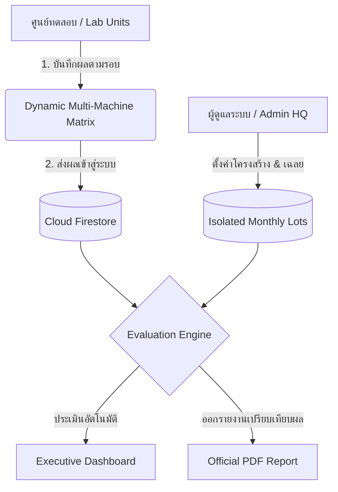

# 🧪 BKT Quality Assessment & Monthly Test Result Portal
### Next-Gen Inter-Laboratory Evaluation & Quality Control Intelligence Platform

  ระบบบริหารจัดการและติดตามผลการทดสอบทางห้องปฏิบัติการมาตรฐานประจำเดือน 
  ขับเคลื่อนด้วยสถาปัตยกรรมคลาวด์แบบ Real-time, โครงสร้างแบบทดสอบระดับมาตรฐาน และการประเมินผลอัตโนมัติ

---

## 🌟 จุดเด่นและสถาปัตยกรรมระบบ (Key Architecture & Features)

- ⚡ **Real-Time Cloud Synchronization & In-Memory Caching:**  
  เชื่อมต่อฐานข้อมูล Google Cloud Firestore เต็มรูปแบบ พร้อมระบบ Smart Memory Cache สลับหน้าจอและเปิดข้อมูลได้ทันใจใน 0ms
- 🧬 **Two-Tier Test Blueprint Engine:**  
  * **โครงสร้างแบบทดสอบ:** รองรับระดับการตรวจวัดหลายระดับ (LV1 / LV2 / LV3) และขยายจำนวนเครื่องตรวจวัดได้อิสระ
  * **รอบ Lot & เฉลยประจำเดือน:** กำหนดช่วงเป้าหมาย (Target Range Min-Max) ประจำรอบการประเมิน
- 🔒 **Data-Layer Secret Key Isolation:**  
  ซ่อนเฉลยในระดับสถาปัตยกรรมข้อมูล ผู้ใช้งานทั่วไปจะได้รับเฉพาะข้อมูลเปิดรอบและเลข Lot โดยไม่มีช่วงค่าเฉลยรั่วไหลผ่านเครือข่าย
- 📊 **Executive Submission Matrix Dashboard:**  
  ตารางติดตามสถานะการลงผล 12 เดือน x ทุกศูนย์ทดสอบ พร้อมตัวกรองติดตามหน่วยงานที่ค้างส่ง และการคำนวณอัตราความสำเร็จประจำเดือน
- 📑 **Instant Official Evaluation & PDF Generator:**  
  ระบบเปรียบเทียบผลกับช่วงค่าเฉลยอัตโนมัติ (Pass / Out of Range) พร้อมออกรายงานประเมินผลมาตรฐาน PDF ได้ในคลิกเดียว

---

## 🏗️ แผนผังการทำงานของระบบ (System Flowchart)

---

## 🛠️ เทคโนโลยีที่เลือกใช้ (Tech Stack)

| ส่วนประกอบ | เทคโนโลยี | รายละเอียด |
| :--- | :--- | :--- |
| **Frontend Core** | Vanilla JavaScript (ES Modules) | ประสิทธิภาพสูง เบา โหลดเร็ว ไม่ต้องพึ่งพา Framework ขนาดใหญ่ |
| **Styling & Icons** | Tailwind CSS + Lucide Icons | ดีไซน์สไตล์ Modern SaaS สะอาดตา ใช้งานง่าย รองรับทุกหน้าจอ |
| **Backend & Cloud** | Google Firebase | Authentication (RBAC) & Cloud Firestore NoSQL Database |
| **Report Engine** | html2pdf.js / Native Print | แปลง DOM สู่เอกสาร PDF รายงานผลมาตรฐานห้องปฏิบัติการ |
| **Build & Deploy** | Vite 6 + Netlify CI/CD | ติดตั้งและอัปเดตระบบอัตโนมัติทุกครั้งที่มีการ Push โค้ด |

---

  Developed with precision and passion for modern quality assurance workflows.

